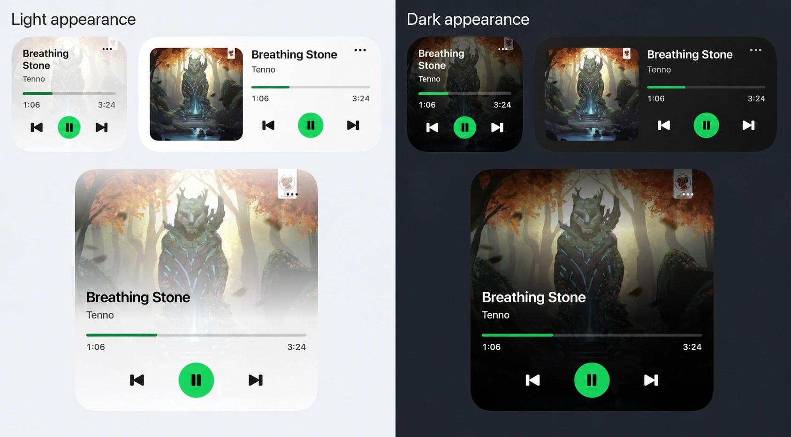
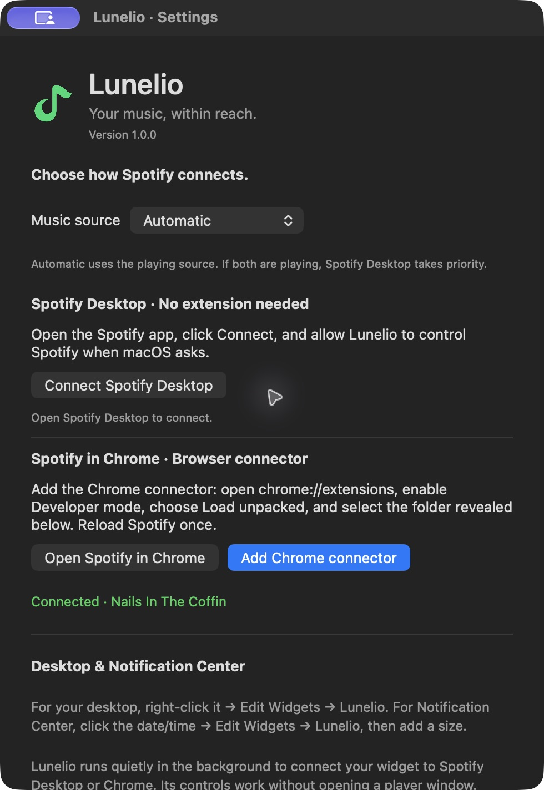

<h1>
  
  Lunelio
</h1>

A handy macOS widget for [Spotify Desktop](https://www.spotify.com/download/mac/) and the [Spotify web player](https://open.spotify.com/).

Keep track of what’s playing and control Spotify quickly from your Mac’s desktop or Notification Center. Play, pause, skip, and seek without switching apps.

Designed to stay lightweight and efficient. Background checks stop when no player is connected, keeping idle activity low.

Free and open source, with all features included. No Spotify Premium subscription or API key required by Lunelio. Spotify’s own playback rules still apply.

[](https://github.com/YRlp98/Lunelio/releases/tag/v1.0.0)
[](LICENSE)
[](https://github.com/YRlp98/Lunelio/stargazers)
[](#current-support)

[](https://github.com/YRlp98/Lunelio/releases/download/v1.0.0/Lunelio-1.0.0.dmg)


## Current support

- **macOS 14 or later.** Support for other operating systems is planned.
- **Spotify Desktop and the Spotify web player in Google Chrome.** More browsers are planned.

Current release: **[1.0.0](https://github.com/YRlp98/Lunelio/releases/tag/v1.0.0)**, with automatic light and dark themes and about **80% lower CPU usage** in our short Chrome playback test. [Changelog](CHANGELOG.md#100--2026-10-24) · [All releases](https://github.com/YRlp98/Lunelio/releases).

## Features

- Small, medium, and large widgets with album artwork, song details, and track progress.
- Light and dark themes that follow the system appearance automatically.
- Play/pause, previous, and next controls.
- Click the progress bar to seek in 10% steps, from 0% to 100%.
- Automatic switching between Spotify Desktop and Chrome based on what’s playing.
- The Chrome helper closes when the last Spotify tab closes and reconnects automatically when needed.
- Start at login and hide the menu-bar icon from Settings.

I’m actively improving Lunelio and adding more features.

## Preview


<details>
  <summary>Light and dark appearance, and Settings</summary>

  <p align="center">
    
  </p>

  <p align="center">
    
  </p>
</details>

<!-- Add a demo GIF here when available. -->

## How to use

Download **[Lunelio-1.0.0.dmg](https://github.com/YRlp98/Lunelio/releases/download/v1.0.0/Lunelio-1.0.0.dmg)**, open it, and drag **Lunelio** to **Applications**. No Xcode is needed to use the app.

The app is not notarized yet. See the [installation guide](Docs/Installing%20Lunelio.md) if macOS blocks it.

1. Open **Lunelio**.
2. Right-click your desktop → **Edit Widgets → Lunelio** and add a small, medium, or large widget. You can also add it in Notification Center.
3. Open **••• → Settings…** on the widget and connect Spotify using either option below.

### Spotify Desktop

1. Download and open [Spotify’s native Mac app](https://www.spotify.com/download/mac/).
2. In Lunelio Settings, click **Connect Spotify Desktop** and allow Lunelio to control Spotify when macOS asks.

No browser extension is needed.

### Spotify web player in Chrome

1. In Lunelio Settings, click **Add Chrome connector** to reveal the connector folder.
2. Open `chrome://extensions`, enable **Developer mode**, click **Load unpacked**, and select that folder.
3. Open [Spotify’s web player](https://open.spotify.com), reload the tab once, and start a song in Spotify. You can then use the widget’s controls.

After updating the connector, reload your Spotify tabs again. If a freshly reopened tab does not start from the widget, click Play in Spotify once.

This also works with Spotify installed as a Chrome web app. Choose **Automatic** in Settings to follow the playing source; Spotify Desktop takes priority when both are playing.

Click the cover to open Spotify, or **•••** for Settings. macOS may delay widget updates.

Lunelio follows the system’s light or dark appearance automatically. No theme switch is needed in the app.

## Development

Open **Lunelio.xcodeproj**, select **Lunelio → My Mac**, then press **⌘R** to run or **⌘U** to test. From the project folder:

```sh
./build.command   # Build the app
./check.command   # Run all regression checks
./package.command # Create the installer in build/Downloads/
```

The current development version is **1.0.0**. The app, widget, and connector share their version in **Config/Version.xcconfig**. The Chrome connection waits for commands during playback and exits when no Spotify tabs remain. Background polling stops when no player is connected. Both reconnect automatically.

See [Editing in Xcode](Docs/Editing%20in%20Xcode.md) for the code map and [Release Guide](Docs/Release%20Guide.md) for distribution details.

## Donate

If you’d like to support Lunelio’s development, donation links will be added here.
