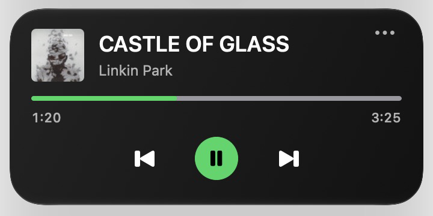
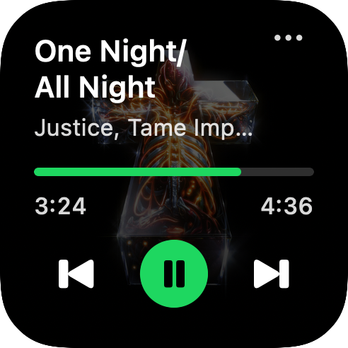
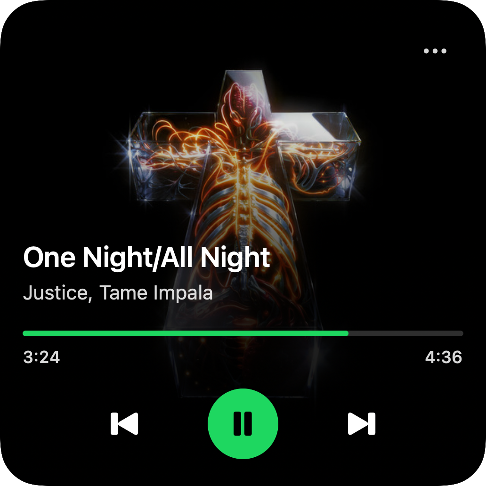
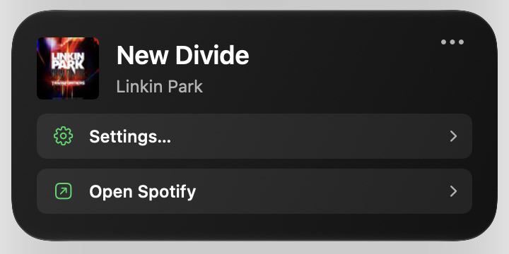
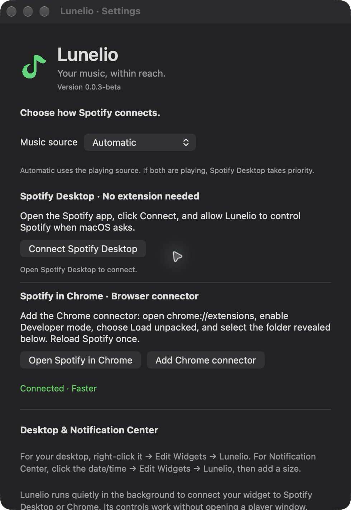

<p align="center">
  
</p>

# Lunelio

**Tiny but handy.**

A small macOS widget for [Spotify Desktop](https://www.spotify.com/download/mac/) and the [Spotify web player](https://open.spotify.com) in Chrome, with support for more browsers planned. See what’s playing, pause, skip, and seek from your desktop or Notification Center.

Free to use. No Spotify Premium subscription or API key required by Lunelio; Spotify’s playback rules still apply.

**macOS 14 or later · 0.0.6-beta**

New in this beta: restart a song from the progress bar, with targets from 0% through 100% in 10% steps. See the [changelog](CHANGELOG.md).

## Preview

<p align="center">
  
</p>

<details>
  <summary>See the small and large widgets, menu, and Settings</summary>

  <p align="center">
    
    
  </p>

  <p align="center">
    
  </p>
  <p align="center">
    
  </p>
</details>

<!-- Add a demo GIF here when available. -->

## Get started

Download **[Lunelio-0.0.6-beta.dmg](https://github.com/YRlp98/Lunelio/releases/download/v0.0.6-beta/Lunelio-0.0.6-beta.dmg)**, open it, and drag **Lunelio** to **Applications**. No Xcode is needed to use the app.

This beta is not notarized yet. See the [installation guide](Docs/Installing%20Lunelio.md) if macOS blocks it. Then:

1. Open **Lunelio**.
2. Right-click your desktop → **Edit Widgets → Lunelio** and add a small, medium, or large widget. You can also add it in Notification Center.
3. Open **••• → Settings…** on the widget and connect Spotify using either option below.

### Spotify Desktop

1. Download and open [Spotify’s native Mac app](https://www.spotify.com/download/mac/).
2. In Lunelio Settings, click **Connect Spotify Desktop** and allow Lunelio to control Spotify when macOS asks.

No browser extension needed. If you previously denied access, enable **Lunelio → Spotify** in **System Settings → Privacy & Security → Automation**.

### Spotify in Chrome

1. In Lunelio Settings, click **Add Chrome connector** to reveal the connector folder.
2. Open `chrome://extensions`, enable **Developer mode**, click **Load unpacked**, and select that folder.
3. Open [Spotify’s web player](https://open.spotify.com) and reload the tab once.

This also works with the [Spotify web player](https://open.spotify.com) installed as a Chrome web app.

## Everyday use

- **Play/pause and skip:** use the playback buttons.
- **Seek:** click along the progress bar.
- **Open Spotify:** click the cover, or the play button when no player is connected.
- **Settings:** click **•••**. You can hide the menu-bar icon or start the connection at login.

Choose **Automatic**, **Spotify Desktop**, or **Spotify in Chrome** in Settings. Automatic follows the playing source, with Desktop taking priority when both are playing.

macOS may delay widget updates. Other browsers, music services, iOS, and iPadOS are not supported yet.

## Development

Open **Lunelio.xcodeproj**, choose **Lunelio → My Mac**, and press **⌘R** to build and run. Use **⌘U** for Swift tests. Local builds do not require a paid Apple developer account.

From the project folder:

```sh
./build.command   # Build the app
./check.command   # Run all regression checks
./package.command # Create the beta installer in build/Downloads/
```

Edit **BrowserExtension/** for browser changes, then rebuild and reload the connector and Spotify tab. Edit **Config/Version.xcconfig** to update the shared app, widget, and connector version.

See [Editing in Xcode](Docs/Editing%20in%20Xcode.md) for the code map and [Release Guide](Docs/Release%20Guide.md) for distribution details.
