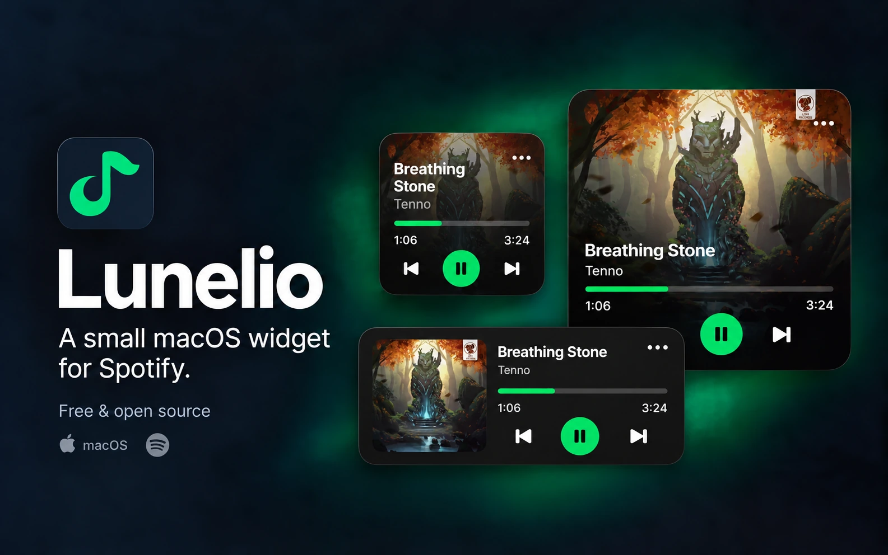
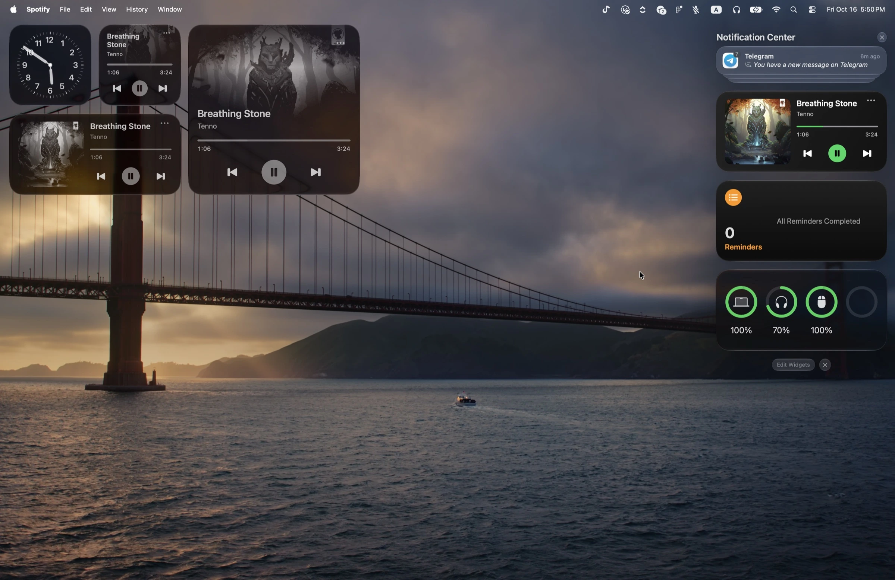
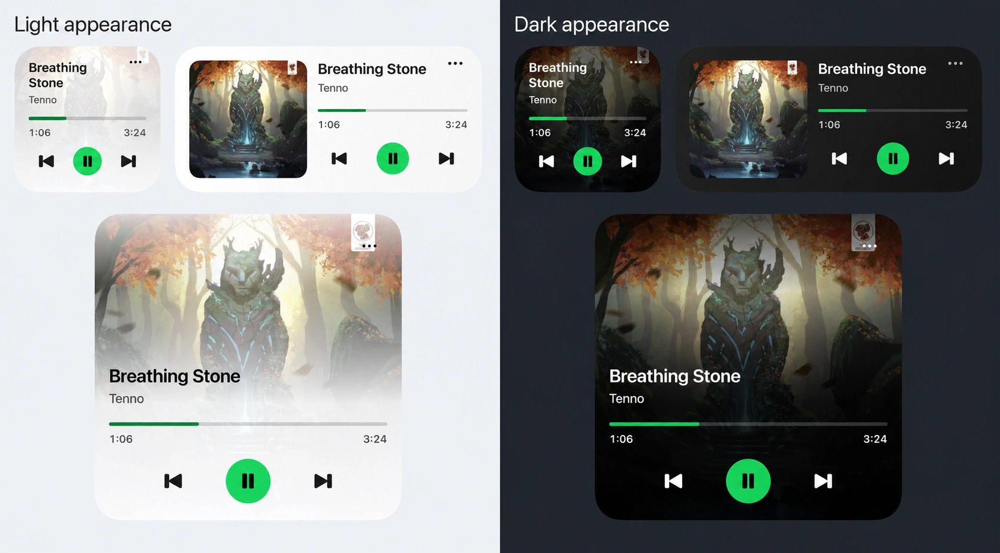
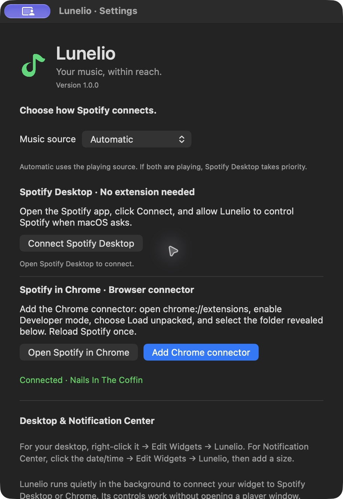

<h1>
  
  Lunelio
</h1>

A handy macOS widget for [Spotify Desktop](https://www.spotify.com/download/mac/) and the [Spotify web player](https://open.spotify.com/).

See what’s playing and control Spotify from your Mac’s desktop or Notification Center. Play, pause, skip, and seek without switching apps.

Lunelio is free and open source, with all features included. It’s built to be lightweight and efficient, and you don’t need Spotify Premium or an API key to use it. Spotify’s own playback rules still apply.

[](https://github.com/YRlp98/Lunelio/releases/tag/v1.0.1)
[](LICENSE)
[](https://github.com/YRlp98/Lunelio/stargazers)
[](https://github.com/YRlp98/Lunelio/releases)
[](#current-support)

[](https://github.com/YRlp98/Lunelio/releases/download/v1.0.1/Lunelio-1.0.1.dmg)



## Current support

- Requires macOS 14 or later. Support for other operating systems is planned.
- Works with Spotify Desktop and the Spotify web player in Google Chrome. More browsers are planned.

Current release: [1.0.1](https://github.com/YRlp98/Lunelio/releases/tag/v1.0.1), with a DNS rebinding protection fix. [Changelog](CHANGELOG.md#101--2026-10-29) · [All releases](https://github.com/YRlp98/Lunelio/releases).

## Features

- Small, medium, and large widgets with album artwork, song details, and track progress.
- Light and dark themes that follow your Mac’s appearance automatically.
- Play/pause, previous, and next controls.
- Click the progress bar to seek in 10% steps, from 0% to 100%.
- Automatic switching between Spotify Desktop and Chrome based on what’s playing.
- Start at login and hide the menu-bar icon from Settings.

I’m working on improvements and new features.

## Preview



<details>
  <summary>Light and dark appearance, and Settings</summary>

  <p align="center">
    
  </p>

  <p align="center">
    
  </p>
</details>

<!-- Add a demo GIF here when available. -->

## How to use

Download [Lunelio-1.0.1.dmg](https://github.com/YRlp98/Lunelio/releases/download/v1.0.1/Lunelio-1.0.1.dmg), open it, and drag **Lunelio** to **Applications**. You don’t need Xcode to use the app.

The app is not notarized yet. See the [installation guide](Docs/Installing%20Lunelio.md) if macOS blocks it.

1. Open **Lunelio**.
2. Right-click your desktop → **Edit Widgets → Lunelio** and add a small, medium, or large widget. You can also add it in Notification Center.
3. Open **••• → Settings…** on the widget and connect Spotify using either option below.

### Spotify Desktop

1. Download and open [Spotify’s native Mac app](https://www.spotify.com/download/mac/).
2. In Lunelio Settings, click **Connect Spotify Desktop** and allow Lunelio to control Spotify when macOS asks.

You don’t need a browser extension for Spotify Desktop.

### Spotify web player in Chrome

1. In Lunelio Settings, click **Add Chrome connector** to reveal the connector folder.
2. Open `chrome://extensions`, enable **Developer mode**, click **Load unpacked**, and select that folder.
3. Open [Spotify’s web player](https://open.spotify.com) and reload the tab once. Start a song in Spotify, then use the widget to control playback.

Reload your Spotify tabs after each connector update. If the widget can’t start playback in a newly reopened tab, click Play in Spotify once.

Spotify installed as a Chrome web app works too. Choose **Automatic** in Settings to follow whichever source is playing. If both are playing, Spotify Desktop takes priority.

Click the cover to open Spotify, or use **•••** for Settings. macOS may delay widget updates.

Lunelio follows your Mac’s light or dark appearance automatically, so there’s no theme setting to change in the app.

## Development

Open **Lunelio.xcodeproj**, select **Lunelio → My Mac**, then press **⌘R** to run or **⌘U** to test. From the project folder:

```sh
./build.command   # Build the app
./check.command   # Run all regression checks
./package.command # Create the installer in build/Downloads/
```

The current development version is **1.0.1**. The app, widget, and connector share their version in **Config/Version.xcconfig**.

See [Editing in Xcode](Docs/Editing%20in%20Xcode.md) for the code map and [Release Guide](Docs/Release%20Guide.md) for distribution details.

## Donate

I’ll add donation links here for anyone who’d like to support Lunelio’s development.
